# Late Deliveries Versus Cancelled Orders Analysis

## Content
- [Business Understanding](https://github.com/ainunjry/Portfolio_2_Food_Deliveries/blob/main/README.md#business-understanding)
- [About The Dataset](https://github.com/ainunjry/Portfolio_2_Food_Deliveries/blob/main/README.md#about-the-dataset)
- [Data Sources](https://github.com/ainunjry/Portfolio_2_Food_Deliveries/blob/main/README.md#data-sources)
- [Tools](https://github.com/ainunjry/Portfolio_2_Food_Deliveries/blob/main/README.md#tools)
- [Business Questions](https://github.com/ainunjry/Portfolio_2_Food_Deliveries/blob/main/README.md#business-questions)
- [Data Cleaning](https://github.com/ainunjry/Portfolio_2_Food_Deliveries/blob/main/README.md#data-cleaning)
- [EDA](https://github.com/ainunjry/Portfolio_2_Food_Deliveries/edit/main/README.md#exploratory-data-analysis)
- [Business Question no.1](https://github.com/ainunjry/Portfolio_2_Food_Deliveries/blob/main/README.md#business-question-no1-)
- [Business Question No.2](https://github.com/ainunjry/Portfolio_2_Food_Deliveries/blob/main/README.md#late-deliveries-analysis-question-no2)
- [Business Question no.3](https://github.com/ainunjry/Portfolio_2_Food_Deliveries/blob/main/README.md#business-question-no3)
- [Business Question no.4](https://github.com/ainunjry/Portfolio_2_Food_Deliveries/blob/main/README.md#business-question-no4)
- [Business Question no.5](https://github.com/ainunjry/Portfolio_2_Food_Deliveries/tree/main#business-question-no5)
- [Key Insight](https://github.com/ainunjry/Portfolio_2_Food_Deliveries/blob/main/README.md#key-insight)
- [Scope and Boundaries](https://github.com/ainunjry/Portfolio_2_Food_Deliveries/blob/main/README.md#scope-and-boundaries)

## Business Understanding
In the food industry, delivery service plays critical role, serving  two sides of same coin alongsides sales.
Delivery performance indisputably has strong correlation with customer satisfaction rate.
Utilizing late versus on-time delivery  trend analysis, as well as two-factor and multi-factor  correlation, 
allows us to uncover specific conditions that lead to optimal high quality delivery performance.

## About The Dataset

#### Data Descriptions
This dataset incorporated  traffic levels, area, weather , hour, and days to analyze delivery times.
These factors drives analysis to dive in how they are associated with delivery performance.
Furthermore, the analysis aims to mitigate existing gaps to optimize delivery time.

#### Column Informations
1.	order_id  : ID of Order
2.	customer_id : ID  of Customer
3.	restaurant_id : ID of Restaurant
4.	driver_id : ID of Driver
5.	order_timestamp : Completed order date with time
6.	order_date : Order date
7.	order_hour : Hour of Order
8.	day_of_week : Days in a week
9.	is_weekend : Binary column , Indicating the days are (0 for weekdays , 1 for weekend)
10.	city : City A,B,C and D
11.	delivery_area : City A-D WITH AREA 1-10
12.	customer_age : Customer age
13.	customer_type : Consists of 3 types: new, regular, and premium
14.	restaurant_type : Consists of 6 categorys : Asian, Burger, Dessert, Healthy, Local, and Pizza
15.	restaurant_primary_category : Consists of 6 categories : Asian, Burger, Dessert, Healthy, Local, and Pizza
16.	restaurant_rating : Rating for restaurant
17.	items_count : Number of items
18.	subtotal: Total price before tax,service fee, delivery fee
19.	discount_percent : Discount of the sub total 
20.	tax_amount : Tax of subtotal
21.	service_fee : restaurant service fee
22.	delivery_fee : Delivery fee
23.	order_total : Total price after tax,service fee, delivery fee
24.	payment_method : Consists of 3 types : Cash, Credit card, Digital wallet
25.	tip_amount : Amount of tip from customers
26.	distance_km : Delivery distance in Kilometre
27.	weather : Consists of 4 types, Clean, Rain, Cloudy,and Storm
28.	traffic_level : Level 0f traffic consists of  high, low,and  medium
29.	delivery_partner_experience_months : How many months  the delivery partners experience
30.	delivery_partner_rating : Rating of the delivery partner
31.	restaurant_preparation_time_minutes : Time period that the restaurant has to prepare the menu for
32.	estimated_delivery_time_minutes : Time period that the delivery has estimated for
33.	actual_delivery_time_minutes : Actual time that delivery has taken for in minutes
34.	late_delivery : Binary column , Indicating  the late and On-time arrivals (0 for no late delivery , 1  for lateness)
35.	order_status : Order status that consists of completed and cancelled
36.	cancellation_reason : A reason for cancelled order
37.	customer_rating : Rating for customers 

[Back to content](https://github.com/ainunjry/Portfolio_2_Food_Deliveries/blob/main/README.md#content)


#### Data Sources
The primary dataset used  for this analysis is RESTAURANT.xlsx from KAGGLE,  containing 37 columns and 50.000 records.
Its columns provided to track the entire operational life cycle fro other placement to final  delivery,
covering  customer demand, restaurant preparation and diriver.

#### Tools

- Google-Colab
  [Download here ](https://github.com/ainunjry/Tools_Project-2_Delivery-Analysis/blob/main/Delivery.ipynb)
- XAMPP PhpMyAdmin - Data analysis
  [Click here to view SQL Queries](https://github.com/ainunjry/Tools_Project-2_Delivery-Analysis/blob/main/Script-portfolio-2-delivery-order.sql)
- Tableau - Visualization

#### Business Questions
1. What drives actual delivery time ?
2. What drives late deliveries ?
3. How accurate are delivery estimates ?
4. Which ones are the operational bottlenecks ?
5. How does delivery performance relate to customer experience ?

## Data Cleaning
**Python Pandas**

- Installing pandas and matplotlib
````python
!pip install pandas
!pip install matplotlib
````

- Importing libraries
````python
import pandas as pd
import matplotlib.pyplot as plt
import seaborn as sns
import numpy as np
````

- Creating variable to read the dataset
- Transforming the dataset into DataFrame
- 
````python
dv = pd.read_excel('RESTAURANT.xlsx')
dv = pd.DataFrame(dv)
print(type(dv))
dv.head()
````

- Identifying the number of rows, datatype of each column and dataset statistic
````python
dv.info()
dv.shape
dv.describe(include='all')
````

- Identifying duplicated rows
````python
dv.duplicated().sum()
````
   output: np.int64(0)

****Missing Values****

- Creating function to identify missing values
````python
ef missing (a,b):
  hasil = a[b].isnull().sum()
  print(f'The number of missing values column {b} : {hasil}')
````
- Using the function
````python
  missing(dv,'tip_amount')
  missing(dv,'subtotal')
  missing(dv,'actual_delivery_time_minutes')
  missing(dv,'late_delivery')
  missing(dv,'customer_rating')
  missing(dv,'restaurant_rating')
````
  Output: 
  - The number of missing values column tip_amount : 868
  - The number of missing values column subtotal : 0
  - The number of missing values column actual_delivery_time_minutes : 868
  - The number of missing values column late_delivery : 868
  - The number of missing values column customer_rating : 868
  - The number of missing values column restaurant_rating : 0


- Creating DataFrame copy
````python
dv1 = dv.copy()
dv1.head(3)
````


- Identifying minimum value column 'tip_amount', the number of rows that contain NOT min_value and min_value
````python
dv1['tip_amount'].min()
(dv1['tip_amount'] != 0.0).sum()
(dv1['tip_amount'] == 0.0).sum()
````

- Replacing missing values & column tip_amount
````python
dv1['tip_amount'].replace(np.nan , dv1['tip_amount'].min(), inplace = True)
````

- The total rows after replacing are 28289 + 868 (missing value) & Identifying the number of rows that contain > 0 value
````python
(dv1['tip_amount'] == 0.0).sum()
(dv1['actual_delivery_time_minutes'] > 0).sum()
````

- Replacing missing values column actual_delivery_time_minutes
````python
dv1['actual_delivery_time_minutes']=dv1['actual_delivery_time_minutes'].fillna(0.0)
dv1['actual_delivery_time_minutes'].isnull().sum()
(dv1['actual_delivery_time_minutes'] == 0.0).sum()
````

- Column : late_delivery
````python
dv1['late_delivery'] = dv1['late_delivery'].fillna('Cancelled order')
dv1['late_delivery'].isnull().sum()
(dv1['late_delivery'] == 'Cancelled order') .sum()
````

- Column : customer_rating & creating function to find out missing valued rows after cleaning
````python
dv1['customer_rating'] = dv1['customer_rating'].fillna(0.0)
dv1['customer_rating'].isnull().sum()
(dv1['customer_rating'] == 0.0).sum()

def rows (a,b):
numbers = (a[b] == 0).sum()
print(f'the number of rows column {b} = 0 are : {numbers}')

rows (dv1,'tip_amount')
rows (dv1,'actual_delivery_time_minutes')
rows (dv1,'late_delivery')
rows (dv1,'customer_rating')
````

Output:

- the number of rows column tip_amount = 0 are : 29157
- the number of rows column actual_delivery_time_minutes = 0 are : 868
- the number of rows column late_delivery = 0 are : 31164
- the number of rows column customer_rating = 0 are : 868

***Interpretation :***
- The missing values of column:
- 'tip_amount': replaced by minimum value of column 0.0.
- 'actual_delivery_time_minutes' : replaced by 0.0, due to cancelled order status.
- 'late_delivery : replaced by " Undefined " due to cancelled order status.
- 'customer_rating' : replaced by 0.0 due to cancelled order status.

- Dropping the 'order_timestamp' column & Transforming datetime column order_date into Y-m-d
````python
dv1.drop(columns= 'order_timestamp', inplace=True)
dv1['new_order_date'] = pd.to_datetime(dv1['order_date']).dt.strftime('%Y-%m-%d')
print(dv1['new_order_date'].dtype)
dv1['new_order_date'] = pd.to_datetime(dv1['new_order_date'])
print(dv1['new_order_date'].dtype)
dv1['new_order_date'] = dv1['new_order_date'].dt.to_period('D')
````

- Transformimg column 'actual_delivery_time_minutes' into interger
````python
dv1['actual_delivery_time_minutes'] = dv1['actual_delivery_time_minutes'].astype('int64')
````

[Back to content](https://github.com/ainunjry/Portfolio_2_Food_Deliveries/blob/main/README.md#content)

## Exploratory Data Analysis

#### Identifying distribution of column : customer_age, distance_km, actual_delivery_time_minutes
#### Creating function to identify: mean, median, skewness and histogram distribution.

````python
def statistic (a,b):
  mean = np.round(a[b].mean(),2)
  median = np.round(a[b].median(),2)
  skewness = a[b].skew()

  print(f"the mean of  {b} column : {mean}")
  print(f"the median of {b} column: {median}")
  print(f"the skewness of{b} column : {skewness}")

statistic(dv1,'customer_age')
````
Output :
- the mean of  customer_age column : 27.69
- the median of customer_age column: 27.0
- the skewness ofcustomer_age column : 0.509064156984098

****Creating KDE Chart of customer_age****
````python
plt.figure(figsize = (4,4))
sns.kdeplot(data=dv1, x='customer_age', fill=False, color='brown')
plt.title("KDE distribution of customer_age")
plt.xlabel("Age")
plt.show()
````
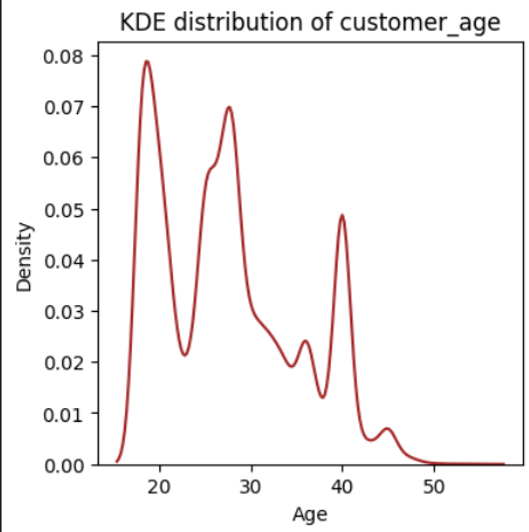

***Interpretation***
- The 3 peaks indicates 3 subs-population in dataset, that range
    18 - 28 years, 29 - 39 years, and over 40 years.
    the median and mean were similar, the gen Z population contributed
    the most delivery-order-customers.

****To generate statistic distance_km & KDE Plot****
````python
statistic(dv1,'distance_km')
````
Output:
- the mean of  distance_km column : 4.73
- the median of distance_km column: 4.1
- the skewness ofdistance_km column : 1.7050089288964454

````python
plt.figure(figsize=(4,4))
sns.kdeplot(data=dv1, x='distance_km', fill=True, color='brown')
plt.title('KDE distribution of Distance in KM')
plt.xlabel('KM')
plt.show()
````

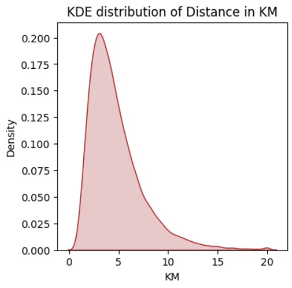


***Interpretation***
- The distance distribution is strongly right skewed,
   It has small number of high values to pull the Mean upward.
   Furthermore,  the Median provides  a more representative view of a typical distance_km.


  ****To generate statistic Actual Delivery Time & KDE Plot****

  ````python
  statistic(dv1, 'actual_delivery_time_minutes')
  ````

  Output:
- the mean of  actual_delivery_time_minutes column : 34.54
- the median of actual_delivery_time_minutes column: 32.0
- the skewness ofactual_delivery_time_minutes column : 1.1576023425072235

````python
plt.figure(figsize=(4,4))
sns.kdeplot(data=dv1, x='actual_delivery_time_minutes', fill=True, color='brown')
plt.title('KDE distribution of actual delivery time in minutes')
plt.xlabel('actual_delivery_time_minutes')
plt.show()
````
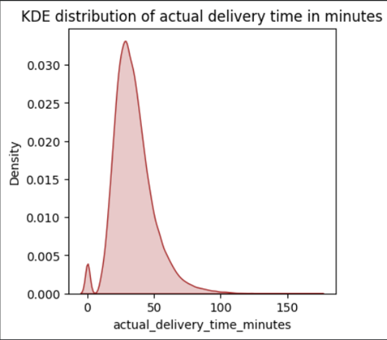

***Interpretation***
- The Mean  of actual delivery time( 34.54 ) is higher than the Median
(32.0), largely a small group of  substantially high-minutes of actual time delivery,
therefore the small group of substantially high-minutes pull the Mean upward,
hence It's strongly right skewed.


***Identifying Outliers columns: 'customer_age', 'actual_delivery_time_minutes', and 'distance_km'***
````python
def otl(c,d):
  Q1 = c[d].quantile(0.25)
  Q3 = c[d].quantile(0.75)
  IQR = Q3 - Q1
  Lower = Q1 - (1.5*Q1)
  Upper = Q3 + (1.5*Q3)

  Outliers = c[d][(c[d] < Lower) | (c[d] > Upper)]
  No_Outliers = c[d][(c[d] >= Lower) & (c[d] <= Upper)]

  print(f'Q1 = {Q1}')
  print(f'Q3 = {Q3}')
  print(f'IQR = {IQR}')
  print(f'Lower = {Lower}')
  print(f'Upper = {Upper}')
  if Outliers.empty:
    print(f'{d} Column has no Outliers')
  else:
    print(f'The number of outliers of {d}: {len(Outliers)}')

otl(dv1,'distance_km')
````
Output: 
- Q1 = 2.8
- Q3 = 5.9
- IQR = 3.1000000000000005
- Lower = -1.3999999999999995
- Upper = 14.750000000000002
- The number of outliers of distance_km: 509

````python
otl(dv1,'customer_age')
````

Output: 
- Q1 = 21.0
- Q3 = 33.0
- IQR = 12.0
- Lower = -10.5
- Upper = 82.5
- customer_age Column has no Outliers

````python
otl(dv1,'actual_delivery_time_minutes')
````
Output:
- Q1 = 25.0
- Q3 = 42.0
- IQR = 17.0
- Lower = -12.5
- Upper = 105.0
- The number of outliers of actual_delivery_time_minutes: 97

***Interpretation***
- The outliers of actual_delivery_time_minutes and distance_km columns were unecessarily aborted,
the plausible external factors were associated with these outliers


[Back to content](https://github.com/ainunjry/Portfolio_2_Food_Deliveries/blob/main/README.md#content)


****Correlation two-column or multi-column****
### Business Question no.1 : 
****What drives 'Actual delivery time' ?****


I.1 Identifying correlation between 2 columns
---
````python
x = dv1[['customer_age','order_hour','distance_km', 'actual_delivery_time_minutes', 'tip_amount', 'restaurant_rating','customer_rating']]
x.corr()
````
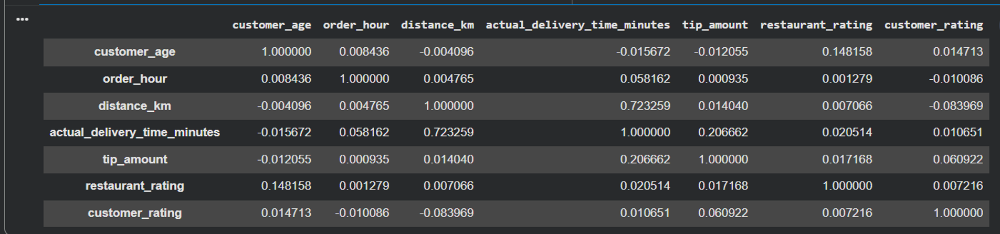

***Interpretation***
- It appeared correlation between column :
    distance_km & actual_delivery_time_minutes
    has postive linear, pearson correlation needed to measure the linear dependance
    between 2 variables.

Importing library Scipy
````python
from scipy import stats
````

I.2 Identifying the correlation strength by pearson
---
````python
pearson_coef,p_value = stats.pearsonr(dv1['distance_km'],dv1['actual_delivery_time_minutes'])
print(f'Pearson_coef: {pearson_coef}')
print(f'P_value : {p_value}')
````
Output:
- Pearson_coef: 0.7232588550246868
- P_value : 0.0

***Interpretation***
- The distance_km and actual_delivery_time_minutes factors
   were linear relationship moderately strong, since the p_value (0.0) measured
    significant correlation.

I.3 Visualizing the correlation by regplot
---
````python
plt.figure(figsize=(4,4))
sns.regplot(data= dv1, x='distance_km', y= 'actual_delivery_time_minutes', color='green')
plt.ylim(0,)
````

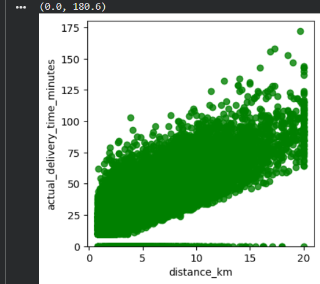

I.4 Identifying the correlation between partner experienced-months and actual delivery time
---
````python
partner = dv1[['delivery_pa rtner_experience_months', 'actual_delivery_time_minutes']]
partner.corr()
````
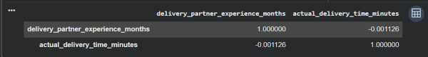

````python
pearson_coef,p_value = stats.pearsonr(dv1['delivery_partner_experience_months'],dv1['actual_delivery_time_minutes'])
print(f'The pearson_coef: {pearson_coef} \n the p_value: {p_value} ')
````
Output:
- The pearson_coef: -0.0011263920488654134 
- the p_value: 0.8011471897507926


***Interpretation***
- Since the p_value > 0.1, the correlation between partner experienced-months
and actual delivery time has no evidence that it's significant, the pearson_coef
measures the two variables most likely do not affect each other.

****I.5 Identifying correlation between Estimated and Actual Delivery time****
---

The code and table have been displayed in Business question no.2


****Conclusion :****
- The distance_km and estimated delivery time are strongly relevant with Actual_delivery_time.

[Back to content](https://github.com/ainunjry/Portfolio_2_Food_Deliveries/blob/main/README.md#content)


### Late Deliveries Analysis Question No.2
****What drives late deliveries ?****

#### II.1 Identifying correlation multi-column by late delivery, indicator = 1
---
````python
est = dv1.groupby('late_delivery')[['restaurant_preparation_time_minutes','actual_delivery_time_minutes','estimated_delivery_time_minutes','delivery_partner_rating','customer_rating','restaurant_rating']].corr()
est
````
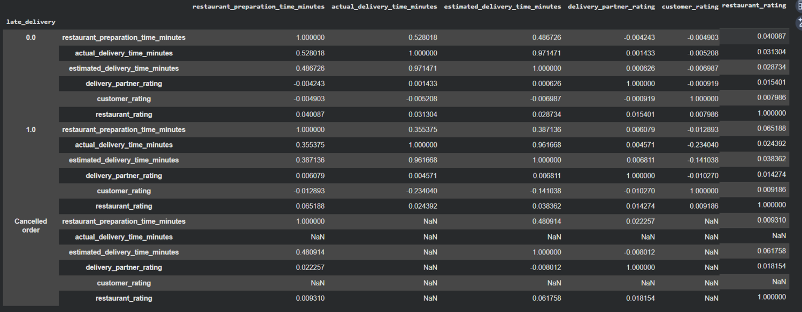

***Interpretation***
- It appeared that 4 columns has strong positive linear for late_delivery category:
- estimated_delivery_time_minutes & actual_delivery_time_minutes : 0.961668,
- restaurant_rating & restaurant_preparation_time_minutes : 0.065188

II.2 Measuring the correlation strength by pearson and p_value
---

````python
pearson_coef,p_value = stats.pearsonr(dv1['restaurant_preparation_time_minutes'],dv1['restaurant_rating'])
print(f'pearson restaurant_rating & preparation_time : {pearson_coef} \n p_value : {p_value}')
````
Output: 
 - pearson restaurant_rating & preparation_time : 0.04421753694673063
 -  p_value : 4.5123150568960764e-23

````python
pearson_coef,p_value = stats.pearsonr(dv1['estimated_delivery_time_minutes'],dv1['actual_delivery_time_minutes'])
print(f'pearson estimated & actual delivery times : {pearson_coef} \n p_value : {p_value}')
````
Output:
- pearson estimated & actual delivery times : 0.8722208050948812
-  p_value : 0.0

***Interpretation***
- Estimated delivery time  and actual delivery time have perfect positive linear correlation
with weak evidence that the correlation is significant. Meanwhile restaurant_preparation_time_minutes
and restaurant_rating have no linear correlation and obviously with either no evidence or
significant correlation across overall late_delivery categories.

[Back to Business question no.1](https://github.com/ainunjry/Portfolio_2_Food_Deliveries/blob/main/README.md#business-question-no1-)

****II.3 Creating bin, label for customer_age and column age_group****
---
````python
bin2 = [17,30,40,50,60]
label =['18 - 29 years', '30 - 40 years', '41 - 50 years', '51 - 60 years']
dv1['age_group'] = pd.cut(dv1['customer_age'],
                          bins = bin2,
                          labels=label)
````

****II.4 Creating group for order_hour****
---
````python
hour = [np.linspace(min(dv1['order_hour']),max(dv1['order_hour']),5)]
day = [-1,6,12,18,23]
label_hour = ['00-06 a.m', '07-12 a.m', '13-18 p.m', '19-23 p.m']
dv1['hour_group'] = pd.cut(dv1['order_hour'],
                           bins = day,
                           labels = label_hour)
````

****II.5 Creating temporary DataFrame variable with Groupby and pivot****
---

````python
late = dv1[['late_delivery', 'restaurant_primary_category','actual_delivery_time_minutes']]
grouped_late = np.round(late.groupby(['late_delivery','restaurant_primary_category'],as_index=False).mean(),1)
late_pivot = grouped_late.pivot(index='late_delivery',columns = 'restaurant_primary_category')
late_pivot
````
Output:

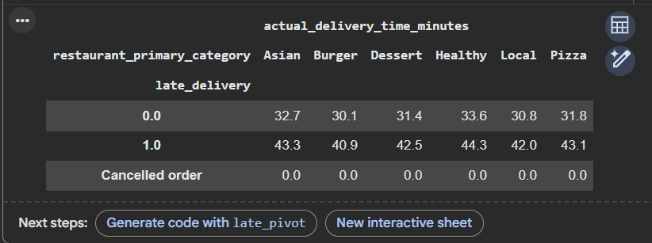

***Interpretation***
- The healthy, Asian and pizza restaurant had the highest rate delay
for actual delivery time at 44.3,43.3, and 43,1 respectively,
contrast with burger that had the shortest time frame in on-time delivery

****II.6 Creating function to identify late delivery in city, hour_group,traffic, weather****
---
````python
def late1 (a,b,c,d):
  late_gr = a[[b,c,d]]
  grby_late = np.round(late_gr.groupby([b,c],as_index=False).mean(),1)
  # Creating pivot
  pivot_grby_late = grby_late.pivot(index= b, columns =c)

  print(f'The Groupby column {b} & {c} from {d} on average : \n {grby_late}')
  print()
  print()
  print(f'The pivot table column {c} with {b} as index: \n {pivot_grby_late}')

late1(dv1,'late_delivery','city','actual_delivery_time_minutes')
````
Output:

- 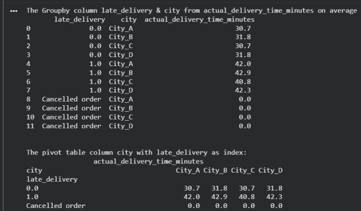

***Interpretation***
- The Actual delivery time for late arrivals of each city is relatively similar.

````python
late1(dv1,'late_delivery','weather','actual_delivery_time_minutes')
````
Output:

- 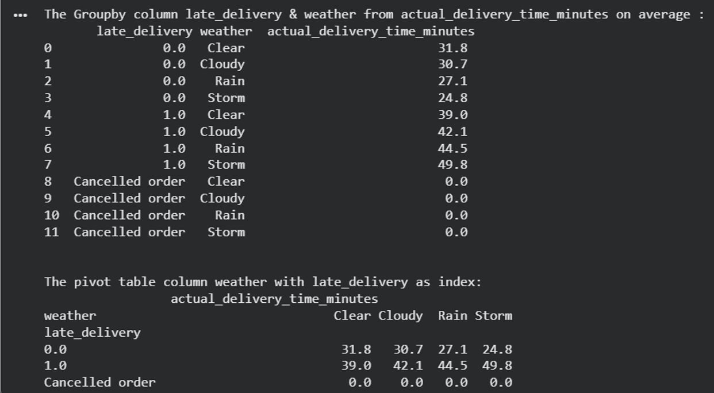

***Interpretation***
- Actual time on average for late arrivals soared in storm.


````python
late1(dv1,'late_delivery','traffic_level','actual_delivery_time_minutes')
````

Output:

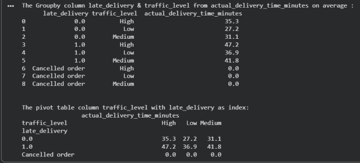

***Interpretation***
-  Actual time on average for late arrivals has high rate in high traffic_level.


II.7 Transforming the datatype hour_group column into string
---
````python
dv1['hour_group'] = dv1['hour_group'].astype(str)
late1(dv1,'late_delivery','hour_group','actual_delivery_time_minutes')
````

Output:

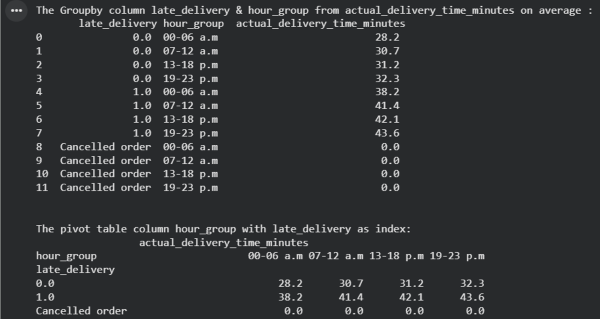


***Interpretation***
- The Storm and high traffic level had the highest rate for delay of actual delivery
     at 49.8 and 47.2 respectively, meanwhile night-delivery at 19-23 p.m  was the most prolonged period on average

***Conclusion***
- The strong relevantly factors that drive late deliveries are weather, traffic level, night deliveries over 7 p.m, and
  actual and estimated delivery time.

[Back to content](https://github.com/ainunjry/Portfolio_2_Food_Deliveries/blob/main/README.md#content)


### Business Question no.3

****How accurate are delivery estimates?****

III.To compare actual and estimated delivery time by visualizing in Tableau
---

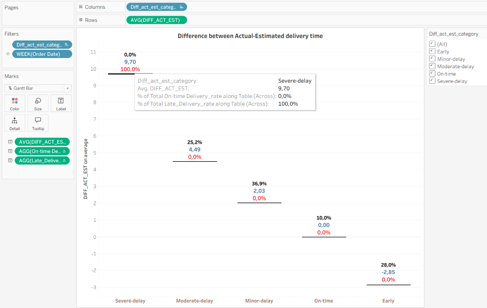

***Interpretation***
- Actual delivery times were 2 -3 minutes (Early) shorter than estimated time, accounted for 28% of total orders
significantly higher than on-time deliveries, that accounted for 10%.
Meanwhile minor dalays of approximately 2 minutes longer than estimated time, reached higher rate at 36%  of total orders,
constrast to severe delays, with bigger difference between actual and estimated time by approximately  9 minutes more


### Business Question no.4

****Where are the operational bottlenecks?****

 Creating function
````python
def late1 (a,b,c,d):
  late_gr = a[[b,c,d]]
  grby_late = np.round(late_gr.groupby([b,c],as_index=False).mean(),1)
  # Creating pivot
  pivot_grby_late = grby_late.pivot(index= b, columns =c)

  print(f'The Groupby column {b} & {c} from {d} on average : \n {grby_late}')
  print()
  print()
  print(f'The pivot table column {c} with {b} as index: \n {pivot_grby_late}')
````
IV.1 Identifying averaged preparation time by restaurant category
---

````python
late1(dv1,'late_delivery','restaurant_primary_category','restaurant_preparation_time_minutes')
````
Output:
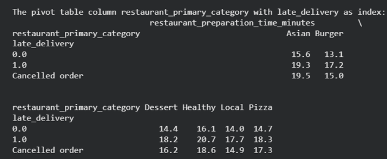

IV.2 Identifying averaged estimated delivery time by restaurant category
---
````python
late1(dv1,'late_delivery','restaurant_primary_category','estimated_delivery_time_minutes' )
````

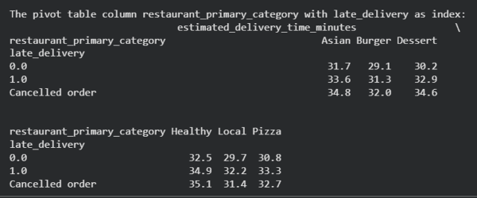

IV.3 Identifying averaged actual delivery time by restaurant category
---
````python
late1(dv1,'late_delivery','restaurant_primary_category','actual_delivery_time_minutes')
````

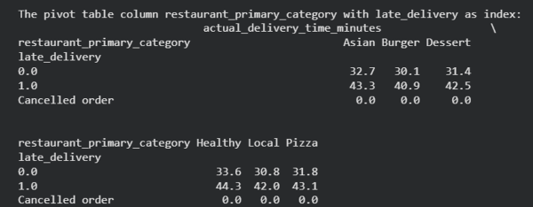

***Interpretation***
- The healthy and Asian restaurant category have the highest rate preparation time,
estimated and actual delivery time on average for late arrivals
at (20.7, 34.9, 44.3) and (19.3, 33.6, 43.3) respectively.


IV.4 Identifying the number of late order volume by restaurant category
---
````python
np.round(pd.crosstab(dv1['restaurant_primary_category'],dv1['late_delivery'],normalize = 'index')*100,1)
````

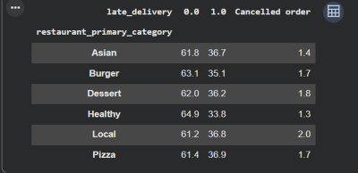


IV.5 Identifying the number of late order volume by hour group
---
````python
np.round(pd.crosstab(dv1['hour_group'],dv1['late_delivery'], normalize ='index')*100,1)
````

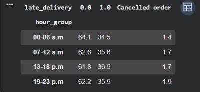

***Interpretation***
- late deliveries volume across restaurant categories and hour_group did not
    differ significantly, the pizza retaurant had the highest rate at 36.9%, and
    36.5% in rush hour (07-12 a.m).

IV.6  Identifying cancelled reason by hour_group
---
````python
np.round(pd.crosstab(dv1['cancellation_reason'],dv1['hour_group'],normalize ='index')*100,1)
````
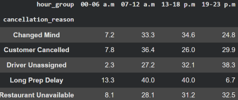

***Interpretation***
- Orders delayed due to long preparation times occurred most frequently from 7:00 a.m. to 6:00 p.m.
  In contrast, orders delayed due to unassigned drivers happened most often at night (after 7:00 p.m.),
  accounting for 38.3%.

IV.7 Late and On-time deliveries volume by partner-experienced-in-months group
---
```sql
SELECT
CASE
  WHEN delivery_partner_experience_months >=1 AND delivery_partner_experience_months <=15 THEN 'new'
  WHEN delivery_partner_experience_months >=16 AND delivery_partner_experience_months <=30 THEN 'developing'
  WHEN delivery_partner_experience_months >=31 AND delivery_partner_experience_months <=45 THEN 'experienced'
  WHEN delivery_partner_experience_months >=46 AND delivery_partner_experience_months <=60 THEN
  'expert'
  END AS partner_exp_group,
COUNT(CASE WHEN late_delivery = 1 THEN order_id END) AS late_arrivals,
COUNT(CASE WHEN late_delivery = 0 THEN order_id END) AS on_time_delivery,
FROM del
GROUP BY partner_exp_group
ORDER BY late_arrivals DESC;
```

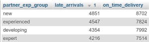

***Interpretation***
- Partners with over 45 months of experience are more capable of mitigating late arrivals,
  though they do not stand out when it comes to maintaining on-time deliveries.

IV.8 Comparing late arrivals by restaurant categories on weekend and weekdays
---
```sql
SELECT 
restaurant_primary_category, 
COUNT(CASE WHEN is_weekend = 1 THEN order_id END) AS Weekend,
COUNT(CASE WHEN is_weekend = 0 THEN order_id END) AS Weekdays,
COUNT(order_id) AS of_orders,
ROUND(AVG(actual_delivery_time_minutes),1) AS AVG_Actual_dtime
FROM del
WHERE late_delivery = 1
GROUP BY restaurant_primary_category
ORDER BY of_orders DESC;
```
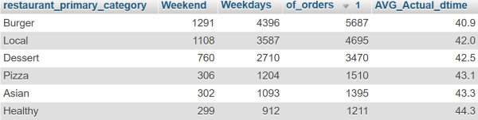

***Interpretation***
- There is a significant relationship between the day of the week (weekdays vs. weekends) and late deliveries,
  with delays occurring much more frequently on weekdays—especially in the Burger and Local restaurant categories.

****Conclusion****
- Operational bottlenecks involve multiple factors, including food preparation time as well as estimated and actual delivery times. Partner tenure (in months) also significantly relevant with late delivery rates and unassigned driver incidents during rush hour. Furthermore, late deliveries occurred nearly 100% more frequently on weekdays compared to weekends.

[Back to content](https://github.com/ainunjry/Portfolio_2_Food_Deliveries/blob/main/README.md#content)

### Business Question No.5

****How does delivery performance relate to customer experience?****

Creating group of the partner-experience-in-months for analyzing the relationship between ratings and total cancelled order count.

V.1 Creating bins and labels for delivery_partner_experience_months
---
````python
partner = [0,15,30,45,60]
label_partner = ['New','Developing','Experienced','Expert']
print(partner)
print()
print(label_partner)
````

V.2  Creating new column for partner experienced grouping
---
````python
dv1['partner_exp_group'] = pd.cut(dv1['delivery_partner_experience_months'],
                                 bins = partner,
                                 labels = label_partner)
````

V.3 Identifying cancelled order volume by partner experienced group
---
````python
np.round(pd.crosstab(dv1['partner_exp_group'],dv1['cancellation_reason'], normalize='index')*100,1)
````

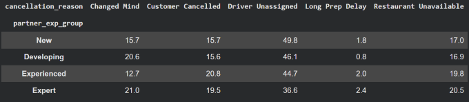


V.4 Identifying cancelled order volume by restaurant category
---
````python
np.round(pd.crosstab(dv1['cancellation_reason'],dv1['restaurant_primary_category'],normalize ='index')*100,1)
````

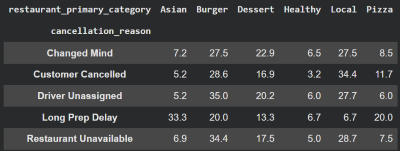


V.5 Identifying cancelled order volume by customer type
---
````python
np.round(pd.crosstab(dv1['cancellation_reason'],dv1['customer_type'],normalize ='index')*100,1)
````

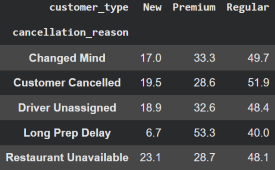


***Interpretation***
- Partners with experience over 30 months  were more capabale to mitigate driver unassigned orders.
  The local one accounted for the highest cancelled orders volume covering 95% of overall cancellation reasons by restaurant category ,
  excluded long preparation delay reason, that Asian category were more dominant.
  In addition, regular customers generated the highest cancelled orders count, recorded over 40% on average.
  

V.6 Identifying cancelled order volume by customer type
----
```sql
SELECT customer_type,
ROUND(AVG(discount_percent),1) AS AVG_discount_percent,
ROUND(AVG(items_count),1) AS AVG_items,
ROUND(AVG(subtotal),1) AS AVG_subtotal,
ROUND(AVG(service_fee),1) AS AVG_service_fee,
ROUND(AVG(delivery_fee),1) AS AVG_delivery_fee,
ROUND(AVG(tip_amount),1) AS AVG_tip_amount,
FORMAT(COUNT(order_id),0) AS of_orders
FROM del
GROUP BY customer_type
ORDER BY of_orders DESC;
```
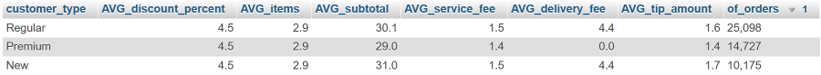

***Interpretation***
- None of significant differences that spent by customers for discount reward , total, item, service fee, dan tip amount among customer types,
  but  premium customers with free charged delivery.

V.7 Identifying driver unassigned orders by partner-experieced group
---
```sql
SELECT							
CASE							
  WHEN delivery_partner_experience_months >=1 AND delivery_partner_experience_months <=15 THEN 'new'							
  WHEN delivery_partner_experience_months >=16 AND delivery_partner_experience_months <=30 THEN 'developing'							
  WHEN delivery_partner_experience_months >=31 AND delivery_partner_experience_months <=45 THEN 'experienced'							
  WHEN delivery_partner_experience_months >=46 AND delivery_partner_experience_months <=60 THEN							
  'expert'							
  END AS partner_exp_group,							
 							
 COUNT(CASE WHEN customer_type = 'New' THEN order_id END) AS new_cst,							
 COUNT(CASE WHEN customer_type = 'Regular' THEN order_id END) AS regular_cst,							
 COUNT(CASE WHEN customer_type = 'Premium' THEN order_id END) AS premium_cst,							
 COUNT(order_id) AS of_orders							
 FROM del							
 WHERE 	cancellation_reason = 'Driver Unassigned'						
 GROUP BY partner_exp_group							
 ORDER BY of_orders DESC;							
```

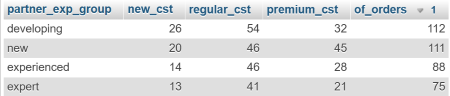

***Interpretation***
- Regular customers accounted for the highest order volume, directly proportional to volume of cancellation orders due to   driver unassigned.

V.8 Identifying restaurant preparation , estimated and actual time on average by cancellation reason
---
```sql
SELECT
     cancellation_reason,
     ROUND(AVG(restaurant_preparation_time_minutes),1) AS AVG_prep_time,
     ROUND(AVG(estimated_delivery_time_minutes),1) AS AVG_estimated_time,
     ROUND(AVG(actual_delivery_time_minutes),1) AS AVG_actual_dtime,
     COUNT(order_id) AS order_volume 
FROM del
GROUP BY cancellation_reason
ORDER BY order_volume;
```
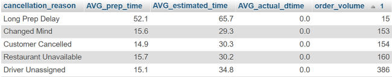

***Interpretation***
- Cancelled order count  due to long preparation delay, recorded the highest an average of  preparation and estimated time.

V.9A Identifying customer, partner, restaurant ratings , estimated dan actual  time on average by customer type with condition customer_rating less than 4.0
---
```sql
SELECT	
   `customer_type`,	
   ROUND(AVG(`customer_rating`),1) AS customer_rt,	
   ROUND(AVG(`restaurant_rating`),1) AS restaurant_rt,	
   ROUND(AVG(`delivery_partner_rating`),1) AS del_partner_rt,	
   ROUND(AVG(`restaurant_preparation_time_minutes`),1) AS rest_pre_time,	
   ROUND(AVG(estimated_delivery_time_minutes),1) AS est_del_time,	
   ROUND(AVG(`actual_delivery_time_minutes`),1) AS act_del_time,	
   FORMAT(COUNT(order_id),0) AS order_volume	
FROM del	
WHERE customer_rating < 4.0	
GROUP BY `customer_type`	
ORDER BY order_volume;	
```
V.9B Identifying customer, partner, restaurant ratings , estimated dan actual  time on average by customer type with condition customer_rating  equal and more than 4.0
---
```sql
SELECT				
   `customer_type`,				
   ROUND(AVG(`customer_rating`),1) AS customer_rt,				
   ROUND(AVG(`restaurant_rating`),1) AS restaurant_rt,				
   ROUND(AVG(`delivery_partner_rating`),1) AS del_partner_rt,				
   ROUND(AVG(`restaurant_preparation_time_minutes`),1) AS rest_pre_time,				
   ROUND(AVG(estimated_delivery_time_minutes),1) AS est_del_time,				
   ROUND(AVG(`actual_delivery_time_minutes`),1) AS act_del_time,				
   FORMAT(COUNT(order_id),0) AS order_volume				
FROM del				
WHERE customer_rating >= 4.0				
GROUP BY `customer_type`				
ORDER BY order_volume;				
```

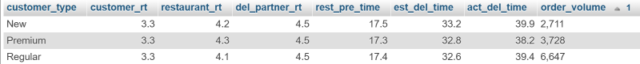

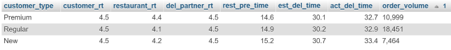


***Interpretation***
- Customers  with  customer_ rating less than 4.0 was more essentially relevant to restaurant preparation time that averaged 17 minutes than estimated and actual delivery time,
contrast to customers with ratings equally or more than 4.0 that restaurant preparation time  generated  14 - 15 minutes.


V.10 Comparing order volume and restaurant preparation time on average on weekend and weekdays
---
```sql
SELECT			
customer_type,			
COUNT(CASE WHEN is_weekend = 1 THEN order_id END) AS _of_order_w_end,			
ROUND(AVG(CASE WHEN is_weekend = 1 THEN `restaurant_preparation_time_minutes` END),1) AS AVG_prep_time_w_end,			
COUNT(CASE WHEN is_weekend = 0 THEN order_id END) AS _of_order_w_days,			
ROUND(AVG(CASE WHEN is_weekend = 0 THEN `restaurant_preparation_time_minutes` END),1) AS AVG_prep_time_w_days			
FROM del			
GROUP BY customer_type			
ORDER BY _of_order_w_end DESC;
```
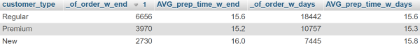

***Interpretation***
- An average of  restaurant preparation time  either on weekend or weekdays was similar,
conversely , order volume on weekdays accounted for two - three as high than the overall volume on weekend.

****Conclusion****
- Customer rating  is essentially related to restaurant preparation time, moreover, cancelled order volume due to long preparation delay  accounted for the highest preparation and estimated rate.
It comes to the highest cancelled order volume related partner-experience in months, generating nearly 45 %  on average due to driver unassigned across all cancellation reason.

### Key Insight

- Emphasizing  on restaurant food preparation time is crucial in the service quality rate.
Customer rating of less and more than 4.0 were more relevant to long preparation delays that recorded 2-3 minute difference,	
and these  rating did not differ significantly to  the restaurant  and partner delivery ratings.	
The proficient and reliable kitchen management, especially food processing, as well as the number and qualification of chefs.	
is strongly recommended  to mitigate average restaurant preparation time rate to below 17 minutes, 	
if  this issue became  unduly  protracted , the cancelled order count due to  long preparation delay would rise.

- Premium customer facilitated with  free charged delivery only, and are not prioritized for restaurant preparation time, 
it accounted for the high cancelled order volume rate due to long-prepare-delay reasons.
The restaurant management must  also evaluates late arrival issues with partner management, 
It is not only partner experience in months has strong relevance, but also how partner management can mitigate the average actual delivery time
especially  regarding   external factors such as on weekdays as well as during  rush hour or  high traffic periods.

- When It comes to cancelled order volume  due to  driver unassigned reason  after 07.00 p.m. ,  
partner management must provide dependable framework to reduce late arrivals and cancelled order volume during  the rush hour.
For instance, providing  alternatively faster alternative routes that avoid traffic congestion, 
by increasing incentive ,altering  the assignment algorithm system,
especially for drivers who are  assigned after 07.00 p.m. , and allocating a number dedicated drivers under shift system.
During these hours, many drivers are exhausted and go home
Hence financial incentives is the right trigger to retain them , regarding natural factors like storm,
this can be bridged with early  information prior to placing orders.


### Scope and Boundaries
Since multi columns are interdependent, either the categories in restaurant or customer type, 
tracking the  lifecycle from preparation time to actual deliveries is crucial to observe its mobility and the relationship.
I dropped some insignificant columns to optimize the file size , for uploading into phpmyadmin such as order_timestamp and delivery_area.
Due to limitatio in tableau version, I have provided visualization in GIF and MP4 format to ensure concice dashboard view.


[Back to content](https://github.com/ainunjry/Portfolio_2_Food_Deliveries/blob/main/README.md#content)


