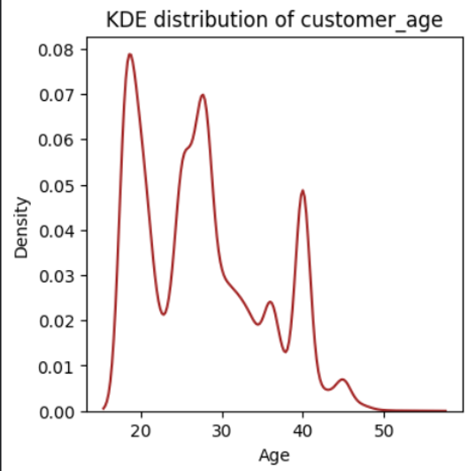
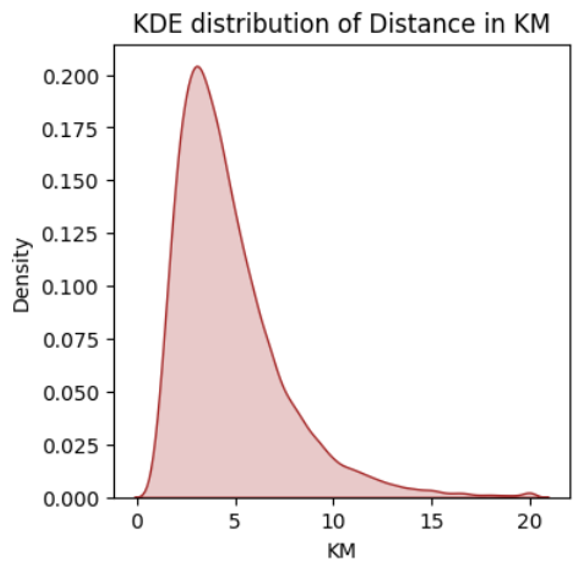
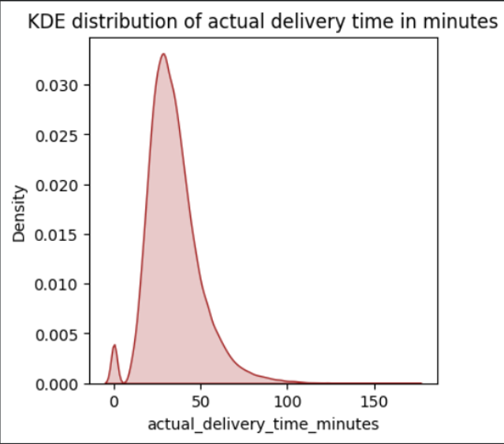

# Late Versus On-Time Food Deliveries Analysis

## Content
- [Business Understanding](https://github.com/ainunjry/Portfolio_2_Food_Deliveries/blob/main/README.md#business-understanding)
- [About The Dataset](https://github.com/ainunjry/Portfolio_2_Food_Deliveries/blob/main/README.md#about-the-dataset)
- [Data Sources](https://github.com/ainunjry/Portfolio_2_Food_Deliveries/blob/main/README.md#data-sources)
- [Tools](https://github.com/ainunjry/Portfolio_2_Food_Deliveries/blob/main/README.md#tools)
- [Business Questions](https://github.com/ainunjry/Portfolio_2_Food_Deliveries/blob/main/README.md#business-questions)
- [Data Cleaning](https://github.com/ainunjry/Portfolio_2_Food_Deliveries/blob/main/README.md#data-cleaning)
- [EDA](https://github.com/ainunjry/Portfolio_2_Food_Deliveries/edit/main/README.md#exploratory-data-analysis)

## Business Understanding
In the food industry, delivery service plays critical role, serving  two sides of same coin alongsides sales.
Delivery performance indisputably has strong correlation with customer satisfaction rate.
Utilizing late versus on-time delivery  trend analysis, as well as two-factor and multi-factor  correlation, 
allows us to uncover specific conditions that lead to optimal high quality delivery performance.

## About The Dataset

#### Data Descriptions
This dataset incorporated  traffic levels, area, weather , hour, and days to analyze delivery times.
These factors drives analysis to dive in how they are associated with delivery performance.
Furthermore, the analysis aims to mitigate existing gaps to optimize delivery time.

#### Column Informations
1.	order_id  : ID of Order
2.	customer_id : ID  of Customer
3.	restaurant_id : ID of Restaurant
4.	driver_id : ID of Driver
5.	order_timestamp : Completed order date with time
6.	order_date : Order date
7.	order_hour : Hour of Order
8.	day_of_week : Days in a week
9.	is_weekend : Binary column , Indicating the days are (0 for weekdays , 1 for weekend)
10.	city : CITY A,B,C and D
11.	delivery_area : CITY A-D WITH AREA 1-10
12.	customer_age : Customer age
13.	customer_type : Consists of 3 types: new, regular, and premium
14.	restaurant_type : Consists of 6 categorys : Asian, Burger, Dessert, Healthy, Local, and Pizza
15.	restaurant_primary_category : Consists of 6 categories : Asian, Burger, Dessert, Healthy, Local, and Pizza
16.	restaurant_rating : Rating for restaurant
17.	items_count : Number of items
18.	subtotal: Total price before tax,service fee, delivery fee
19.	discount_percent : Discount of the sub total 
20.	tax_amount : Tax of subtotal
21.	service_fee : restaurant service fee
22.	delivery_fee : Delivery fee
23.	order_total : Total price after tax,service fee, delivery fee
24.	payment_method : Consists of 3 types : Cash, Credit card, Digital wallet
25.	tip_amount : Amount of tip from customers
26.	distance_km : Delivery distance in Kilometre
27.	weather : Consists of 4 types, Clean, Rain, Cloudy,and Storm
28.	traffic_level : Level 0f traffic consists of  high, low,and  medium
29.	delivery_partner_experience_months : How many months  the delivery partners experience
30.	delivery_partner_rating : Rating of the delivery partner
31.	restaurant_preparation_time_minutes : Time period that the restaurant has to prepare the menu for
32.	estimated_delivery_time_minutes : Time period that the delivery has estimated for
33.	actual_delivery_time_minutes : Actual time that delivery has taken for in minutes
34.	late_delivery : Binary column , Indicating  the late and On-time arrivals (0 for no late delivery , 1  for lateness)
35.	order_status : Order status that consists of completed and cancelled
36.	cancellation_reason : A reason for cancelled order
37.	customer_rating : Rating for customers 

[Back to content](https://github.com/ainunjry/Portfolio_2_Food_Deliveries/blob/main/README.md#content)


#### Data Sources


#### Tools

- Google-Colab
  [Download here ](https://github.com/ainunjry/Tools_Project-2_Delivery-Analysis/blob/main/Delivery.ipynb)
- XAMPP PhpMyAdmin - Data analysis
- Tableau - Visualization

#### Business Questions
1. What drives actual delivery time ?
2. What drives late deliveries ?
3. How accurate are delivery estimates ?
4. Which ones are the operational bottlenecks ?
5. How does delivery performance relate to customer experience ?

## Data Cleaning
**Python Pandas**

- Installing pandas and matplotlib
````python
!pip install pandas
!pip install matplotlib
````

- Importing libraries
````python
import pandas as pd
import matplotlib.pyplot as plt
import seaborn as sns
import numpy as np
````

- Creating variable to read the dataset
- Transforming the dataset into DataFrame
- 
````python
dv = pd.read_excel('RESTAURANT.xlsx')
dv = pd.DataFrame(dv)
print(type(dv))
dv.head()
````

- Identifying the number of rows, datatype of each column and dataset statistic
````python
dv.info()
dv.shape
dv.describe(include='all')
````

- Identifying duplicated rows
````python
dv.duplicated().sum()
````
   output: np.int64(0)

****Missing Values****

- Creating function to identify missing values
````python
ef missing (a,b):
  hasil = a[b].isnull().sum()
  print(f'The number of missing values column {b} : {hasil}')
````
- Using the function
````python
  missing(dv,'tip_amount')
  missing(dv,'subtotal')
  missing(dv,'actual_delivery_time_minutes')
  missing(dv,'late_delivery')
  missing(dv,'customer_rating')
  missing(dv,'restaurant_rating')
````
  Output: 
  - The number of missing values column tip_amount : 868
  - The number of missing values column subtotal : 0
  - The number of missing values column actual_delivery_time_minutes : 868
  - The number of missing values column late_delivery : 868
  - The number of missing values column customer_rating : 868
  - The number of missing values column restaurant_rating : 0


- Creating DataFrame copy
````python
dv1 = dv.copy()
dv1.head(3)
````


- Identifying minimum value column 'tip_amount', the number of rows that contain NOT min_value and min_value
````python
dv1['tip_amount'].min()
(dv1['tip_amount'] != 0.0).sum()
(dv1['tip_amount'] == 0.0).sum()
````

- Replacing missing values & column tip_amount
````python
dv1['tip_amount'].replace(np.nan , dv1['tip_amount'].min(), inplace = True)
````

- The total rows after replacing are 28289 + 868 (missing value) & Identifying the number of rows that contain > 0 value
````python
(dv1['tip_amount'] == 0.0).sum()
(dv1['actual_delivery_time_minutes'] > 0).sum()
````

- Replacing missing values column actual_delivery_time_minutes
````python
dv1['actual_delivery_time_minutes']=dv1['actual_delivery_time_minutes'].fillna(0.0)
dv1['actual_delivery_time_minutes'].isnull().sum()
(dv1['actual_delivery_time_minutes'] == 0.0).sum()
````

- Column : late_delivery
````python
dv1['late_delivery'] = dv1['late_delivery'].fillna('Cancelled order')
dv1['late_delivery'].isnull().sum()
(dv1['late_delivery'] == 'Cancelled order') .sum()
````

- Column : customer_rating & creating function to find out missing valued rows after cleaning
````python
dv1['customer_rating'] = dv1['customer_rating'].fillna(0.0)
dv1['customer_rating'].isnull().sum()
(dv1['customer_rating'] == 0.0).sum()

def rows (a,b):
numbers = (a[b] == 0).sum()
print(f'the number of rows column {b} = 0 are : {numbers}')

rows (dv1,'tip_amount')
rows (dv1,'actual_delivery_time_minutes')
rows (dv1,'late_delivery')
rows (dv1,'customer_rating')
````

Output:

- the number of rows column tip_amount = 0 are : 29157
- the number of rows column actual_delivery_time_minutes = 0 are : 868
- the number of rows column late_delivery = 0 are : 31164
- the number of rows column customer_rating = 0 are : 868

***Interpretation :***
- The missing values of column:
- 'tip_amount': replaced by minimum value of column 0.0.
- 'actual_delivery_time_minutes' : replaced by 0.0, due to cancelled order status.
- 'late_delivery : replaced by " Undefined " due to cancelled order status.
- 'customer_rating' : replaced by 0.0 due to cancelled order status.

- Dropping the 'order_timestamp' column & Transforming datetime column order_date into Y-m-d
````python
dv1.drop(columns= 'order_timestamp', inplace=True)
dv1['new_order_date'] = pd.to_datetime(dv1['order_date']).dt.strftime('%Y-%m-%d')
print(dv1['new_order_date'].dtype)
dv1['new_order_date'] = pd.to_datetime(dv1['new_order_date'])
print(dv1['new_order_date'].dtype)
dv1['new_order_date'] = dv1['new_order_date'].dt.to_period('D')
````

- Transformimg column 'actual_delivery_time_minutes' into interger
````python
dv1['actual_delivery_time_minutes'] = dv1['actual_delivery_time_minutes'].astype('int64')
````

[Back to content](https://github.com/ainunjry/Portfolio_2_Food_Deliveries/blob/main/README.md#content)

## Exploratory Data Analysis

#### Identifying distribution of column : customer_age, distance_km, actual_delivery_time_minutes
#### Creating function to identify: mean, median, skewness and histogram distribution.

````python
def statistic (a,b):
  mean = np.round(a[b].mean(),2)
  median = np.round(a[b].median(),2)
  skewness = a[b].skew()

  print(f"the mean of  {b} column : {mean}")
  print(f"the median of {b} column: {median}")
  print(f"the skewness of{b} column : {skewness}")

statistic(dv1,'customer_age')
````
Output :
- the mean of  customer_age column : 27.69
- the median of customer_age column: 27.0
- the skewness ofcustomer_age column : 0.509064156984098

****Creating KDE Chart of customer_age****
````python
plt.figure(figsize = (4,4))
sns.kdeplot(data=dv1, x='customer_age', fill=False, color='brown')
plt.title("KDE distribution of customer_age")
plt.xlabel("Age")
plt.show()
````


***Interpretation***
- The 3 peaks indicates 3 subs-population in dataset, that range
    18 - 28 years, 29 - 39 years, and over 40 years.
    the median and mean were similar, the gen Z population contributed
    the most delivery-order-customers.

****To generate statistic distance_km & KDE Plot****
````python
statistic(dv1,'distance_km')
````
Output:
- the mean of  distance_km column : 4.73
- the median of distance_km column: 4.1
- the skewness ofdistance_km column : 1.7050089288964454

````python
plt.figure(figsize=(4,4))
sns.kdeplot(data=dv1, x='distance_km', fill=True, color='brown')
plt.title('KDE distribution of Distance in KM')
plt.xlabel('KM')
plt.show()
````




***Interpretation***
- The distance distribution is strongly right skewed,
   It has small number of high values to pull the Mean upward.
   Furthermore,  the Median provides  a more representative view of a typical distance_km.


  ****To generate statistic Actual Delivery Time & KDE Plot****

  ````python
  statistic(dv1, 'actual_delivery_time_minutes')
  ````

  Output:
- the mean of  actual_delivery_time_minutes column : 34.54
- the median of actual_delivery_time_minutes column: 32.0
- the skewness ofactual_delivery_time_minutes column : 1.1576023425072235

````python
plt.figure(figsize=(4,4))
sns.kdeplot(data=dv1, x='actual_delivery_time_minutes', fill=True, color='brown')
plt.title('KDE distribution of actual delivery time in minutes')
plt.xlabel('actual_delivery_time_minutes')
plt.show()
````


***Interpretation***
- The Mean  of actual delivery time( 34.54 ) is higher than the Median
(32.0), largely a small group of  substantially high-minutes of actual time delivery,
therefore the small group of substantially high-minutes pull the Mean upward,
hence It's strongly right skewed.


***Identifying Outliers columns: 'customer_age', 'actual_delivery_time_minutes', and 'distance_km'***
````python
def otl(c,d):
  Q1 = c[d].quantile(0.25)
  Q3 = c[d].quantile(0.75)
  IQR = Q3 - Q1
  Lower = Q1 - (1.5*Q1)
  Upper = Q3 + (1.5*Q3)

  Outliers = c[d][(c[d] < Lower) | (c[d] > Upper)]
  No_Outliers = c[d][(c[d] >= Lower) & (c[d] <= Upper)]

  print(f'Q1 = {Q1}')
  print(f'Q3 = {Q3}')
  print(f'IQR = {IQR}')
  print(f'Lower = {Lower}')
  print(f'Upper = {Upper}')
  if Outliers.empty:
    print(f'{d} Column has no Outliers')
  else:
    print(f'The number of outliers of {d}: {len(Outliers)}')

otl(dv1,'distance_km')
````
Output: 
- Q1 = 2.8
- Q3 = 5.9
- IQR = 3.1000000000000005
- Lower = -1.3999999999999995
- Upper = 14.750000000000002
- The number of outliers of distance_km: 509

````python
otl(dv1,'customer_age')
````

Output: 
- Q1 = 21.0
- Q3 = 33.0
- IQR = 12.0
- Lower = -10.5
- Upper = 82.5
- customer_age Column has no Outliers

````python
otl(dv1,'actual_delivery_time_minutes')
````
Output:
- Q1 = 25.0
- Q3 = 42.0
- IQR = 17.0
- Lower = -12.5
- Upper = 105.0
- The number of outliers of actual_delivery_time_minutes: 97


